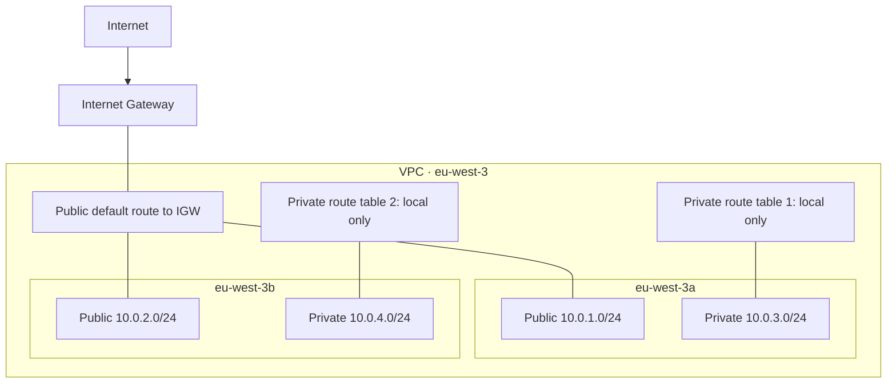

# AWS Terraform Network & Delivery Lab

[](https://github.com/meng81593-byte/aws-terraform-network-lab/actions/workflows/terraform-ci.yml)


A cloud engineering portfolio lab: define and verify AWS network boundaries with Terraform, then connect them to a short-lived container delivery experiment for [Little Steps DevOps](https://github.com/meng81593-byte/little-steps-devops).

## Network foundation

- VPC `10.0.0.0/16` with DNS support and DNS hostnames enabled.
- Public subnets `10.0.1.0/24` and `10.0.2.0/24` in `eu-west-3a` and `eu-west-3b`.
- Private subnets `10.0.3.0/24` and `10.0.4.0/24` in the same two zones.
- Internet Gateway, public default route, and explicit route-table associations.
- Explicit private route tables with local VPC routing only; no NAT or Internet default route.
- Automatic public IPv4 assignment is disabled on all subnets; the demo service opts in explicitly where needed.
- Input variables, integration outputs, resource tags, provider version constraints, and a committed lockfile.
- Native Terraform mock tests and GitHub Actions validation/configuration scanning.

The root lab defines **14 explicit resources**. AWS also creates default VPC resources. Two Availability Zones provide a workload foundation; they do not establish application high availability on their own.



## Run and verify

Prerequisites: Terraform `>=1.7, <2.0`, a configured AWS identity, and permission to manage these lab resources. Tested locally with Terraform 1.16.2 and AWS provider 6.68.0. Provider constraints select major version 6; the lockfile records the resolved version.

```bash
git clone https://github.com/meng81593-byte/aws-terraform-network-lab.git
cd aws-terraform-network-lab
terraform init -lockfile=readonly
terraform fmt -check -recursive
terraform validate
terraform test
```

The tests use a mock AWS provider and create no cloud resources. For a real deployment, review variables and the AWS account first:

```bash
aws sts get-caller-identity
terraform plan
terraform apply
```

Default names preserve the original `little-steps` lab. An existing VPC with those names is **not automatically imported**. If you already deployed the lab, use its original state directory or deliberately import it; do not unintentionally create a duplicate from a new clone.

Verify all subnet CIDRs/zones, public and private route associations, DNS settings, and the public default route in AWS. Repeat `terraform plan` after applying; an unchanged deployment should report no changes. Network configuration checks do not substitute for testing actual workload traffic.

## Variables and outputs

Copy the sanitized `terraform.tfvars.example` when customizing the region, project name, VPC CIDR, two zones, and subnet CIDRs. Choose valid, non-overlapping subnets contained in the VPC. Update zones together with the region.

Outputs expose the VPC ID, public/private subnet IDs, and route table IDs. Use `terraform output` to inspect them locally; avoid publishing raw state or account metadata in screenshots.

## Container delivery experiment

See [delivery/README.md](delivery/README.md). The separate components define:

- ECR with immutable image tags and a GitHub OIDC publisher role restricted to the application repository's chosen branch.
- A dedicated experiment VPC, ALB, Fargate service, health checks, logs, and rollback configuration.
- Deployment using an image digest, with explicit cost and cleanup instructions.

The experiment uses a distinct prefix and `10.42.0.0/16` CIDR to preserve the original lab. It is an operations exercise, with one task by default and short-lived HTTP hosting. It is not described as a permanent production environment.

## State, cleanup, and evidence

Keep state private. `.gitignore` excludes state, local variable files, saved plans, and Terraform working directories; `.terraform.lock.hcl` is committed. Use the same state and account to clean up:

```bash
terraform destroy
```

Review the plan before confirming. Destroy only resources owned by this lab, and retain state until cleanup succeeds. Read [state management](docs/state-management.md) before shared or CI operation. That document explains S3 encryption, versioning, native state locks, and migration; a remote backend is not silently enabled by this repository.

Verified checks, the live deployment and recovery exercise, and same-day cleanup are recorded in [verification.md](docs/verification.md).
