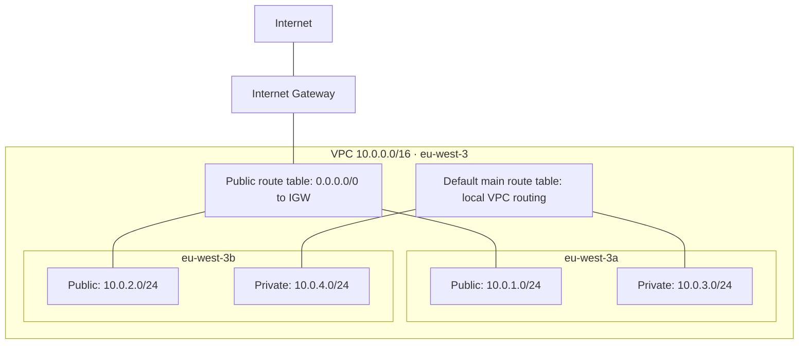

# AWS Terraform Network Lab


A Terraform learning project that defines an AWS VPC with public and private subnets across two Availability Zones in the Paris region.

The goal is to understand subnet isolation, Internet Gateway routing, and infrastructure dependencies before deploying an application. This repository currently defines the network foundation; it does not deploy the Little Steps application.

## What is implemented

- One VPC: `10.0.0.0/16`, with DNS support and DNS hostnames enabled.
- Two public subnets: `10.0.1.0/24` in `eu-west-3a` and `10.0.2.0/24` in `eu-west-3b`.
- Two private subnets: `10.0.3.0/24` in `eu-west-3a` and `10.0.4.0/24` in `eu-west-3b`.
- An Internet Gateway attached to the VPC.
- A public route table with `0.0.0.0/0` routed to the Internet Gateway.
- Explicit public route table associations for both public subnets.
- Public IPv4 auto-assignment enabled on the public subnets.

There are 10 explicitly declared Terraform resources. AWS also creates default VPC resources implicitly.

## Architecture



The private subnets use the VPC's main route table because no private route table associations are declared. In a newly created VPC, this provides local VPC routing, with no Internet default route configured by this project. There is no NAT Gateway.

Two Availability Zones provide a foundation for a resilient workload, but subnet placement alone does not establish application high availability.

## Repository structure

```text
.
├── main.tf       # Provider and network resources
├── .gitignore    # Excludes Terraform working directory and local state files
└── README.md
```

## Prerequisites

- Terraform CLI.
- AWS CLI for checking your authenticated identity.
- An AWS account and a locally configured AWS profile with permission to manage the declared VPC resources.

The current code does not pin the Terraform CLI or AWS provider version. Record the versions used for your deployment and commit `.terraform.lock.hcl` after initialization to make provider selection reproducible.

## Run the lab

```bash
git clone https://github.com/meng81593-byte/aws-terraform-network-lab.git
cd aws-terraform-network-lab
aws sts get-caller-identity
terraform init
terraform fmt -check
terraform validate
terraform plan
```

If the formatting check fails, run `terraform fmt`, review the change, and repeat the check. Confirm the AWS account and review the plan before creating resources:

```bash
terraform apply
```

Review the new plan shown by `apply`, then enter `yes` when it matches your intended changes. The region is hardcoded to `eu-west-3`; changing only your AWS CLI default region does not change this provider configuration.

## Verify the result

1. In the AWS VPC console, select `eu-west-3` and find `little-steps-vpc`.
2. Confirm all four subnet CIDRs and their Availability Zones.
3. Confirm both public subnets are associated with `little-steps-public-rt`.
4. Confirm its default route targets `little-steps-igw`.
5. Confirm the private subnets have no Internet default route.
6. Run `terraform plan` again: an unchanged deployment should show no changes.

These steps verify the network configuration. End-to-end connectivity testing requires a separately deployed workload; no EC2 instance, load balancer, or container service is created here.

## Cleanup and state handling

Run from the same working directory, with the same state and AWS account:

```bash
terraform destroy
```

Review the destruction plan before confirming. Remove any separately created workloads that prevent subnet or VPC deletion. Keep the state until cleanup is complete.

Do not commit AWS credentials, Terraform state, or saved plan files. The current `.gitignore` excludes `.terraform/`, `terraform.tfstate`, and `terraform.tfstate.backup`; extend it before introducing other state filenames, local variable files, or saved plans.

## Current limitations

- Local state only; no remote backend or shared state locking configuration.
- Region, Availability Zones, CIDRs, and names are hardcoded.
- No outputs, version constraints, or automated validation workflow.
- No explicitly managed private route tables, NAT, VPC endpoints, or workload security groups.
- No deployment logs or connectivity test results are included.

## Next milestones

- [ ] Add version constraints, variables, outputs, and a committed provider lockfile.
- [ ] Explicitly manage private route tables and their associations.
- [ ] Add CI for formatting, initialization without a backend, validation, and configuration scanning.
- [ ] Document a repeatable apply / verify / destroy exercise.
- [ ] Add an S3 state backend with encryption, versioning, and S3 lockfile support when shared operation is needed.
- [ ] Connect the network to a separately defined container deployment, documenting egress and cost choices.

Related application: [Little Steps DevOps](https://github.com/meng81593-byte/little-steps-devops).
